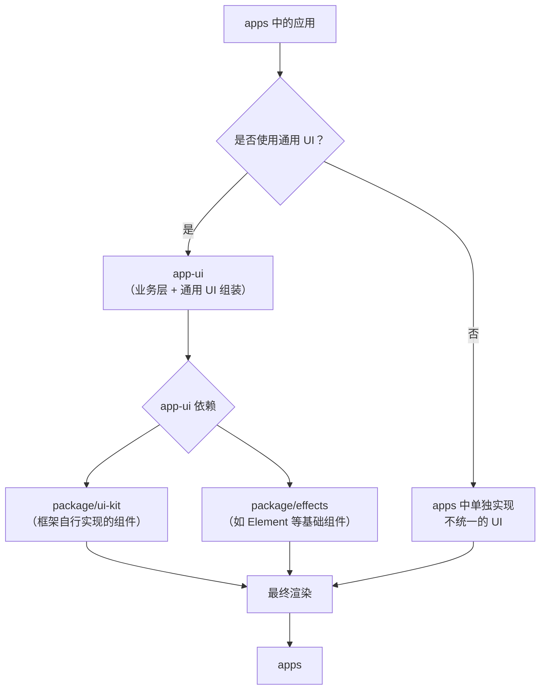
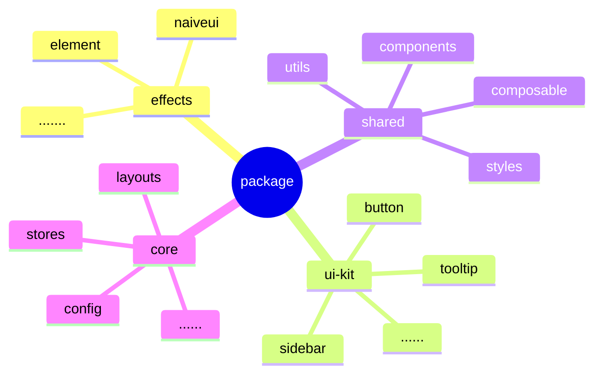

## 框架介绍

框架定位是为了方便自己快捷开发而诞生的。同时也是为了让自己熟悉pnpm、turboRepo等，主要是为了学习吧。

框架内置的状态管理是使用的的pinia（限于Vue），对于非使用pinia的、需迁入本框架的Vue项目，需要自行去修改代码迁入。

框架的下层组件基本都是基于使用shadcn/ui的，若后续需要改为react去开发，是允许在`package/ui-kit/react-ui`创建的（只要你配置好了tsconfig.json、vite.config.ts、components.json）。注意要使用shadcn库，而不是shadcn-vue了。

因为react、vue之间的生态是不一致的，所以后续应该会优化`internal/vite-config`提供的`defineViteConfig`方法，让其自动检测`apps`中的框架，然后使用对应的生态，但这是后话了。肯定还是需要使用`package.json`管理好依赖的


`package/effects`是专门负责第三方组件库的接入适配的，后续会提供一个适配器，让框架去接管第三方组件的configProvider的配置，统一第三方组件库的圆角、按钮大小等。

除了可以使用`package/effects`接入的第三方组件库外，框架内部`package/ui-kit`是基于`shadcn/ui`的自行实现的组件


### 技术栈

如果你使用的是Vue3，那么：

- pinia
- vue-router
- typescript
- turboRepo
- pnpm
- vite
- tailwindcss v4
- vue


## 目录结构
```sh
后续补充
```

如果你是为了实现业务去开发，只需要关注apps，在apps中编写代码就可以，你可以使用vite去创建基础骨架去开发，然后按照迁入指南接入到本框架中。当然你copy演示应用也可以。


## 框架目录介绍




### package目录

其目录大致分布如下图。



### internal目录

这个目录主要是为了统一一些配置，如typescript、vite、eslint等可以统一的配置。

目前有：`eslint-config`、`typescript-config`、`vite-config`

## 引入shadcn-vue

```bash
cd airovo-frame
pnpm dlx shadcn-vue@latest add [COMPONENT] -c packages/ui-kit/vue-ui
```

---

## 路由系统

业务模块声明路由结构（路径、标题、图标、组件懒加载），`@airovo/router` 负责转换成 vue-router 格式并派生侧边栏菜单。

### 文件结构

```
packages/core/router/src/
  types.ts        # AppRouter, RouterOptions, PreferencesBridge（vue-router 特有）
  routeTypes.ts   # AgnosticRouteRecord, MenuItem, MenusMod, RouteMeta（纯 TS）
  derive.ts       # deriveMenus(routes) — 路由树 → 菜单树
  merge.ts        # mergeMenus(local, dynamic, mod) — 合并菜单
  load.ts         # loadAllModules(patterns, globs) — glob 加载器
  adapter.ts      # toVueRoutes(records) — AgnosticRouteRecord → RouteRecordRaw
  createRouter.ts # createAppRouter(options) — 工厂函数
  modules/        # 框架内置路由（login、redirect、404）
  views/          # 框架内置视图（.vue）
```

### 包导出

`@airovo/router` 是唯一的路由入口：

| 导出 | 职责 |
|---|---|
| `createAppRouter(options)` | 工厂函数：转换并注册 vue-router 路由 |
| `toVueRoutes(records)` | `AgnosticRouteRecord[]` → `RouteRecordRaw[]` 转换器 |
| `coreRoutes` | 框架内置路由（login / redirect / 404） |
| `deriveMenus(routes)` | 从路由树派生 `MenuItem[]` |
| `mergeMenus(local, dynamic, mod)` | 按菜单模式合并本地/动态菜单 |
| `loadAllModules(patterns, globs)` | 通用的 glob 模块加载器 |
| `RouterOptions` / `AppRouter` | 适配器选项 + 返回值类型 |
| `AgnosticRouteRecord` / `MenuItem` / `MenusMod` / `RouteMeta` | 路由 + 菜单的类型 |

### 业务模块

业务层只接触 `@airovo/router` 的类型，不直接导入 `vue-router`：

```ts
import type { AgnosticRouteRecord } from '@airovo/router'

const Overview = () => import('../../../views/Overview.vue')

const dashboard: AgnosticRouteRecord = {
    path: '/dashboard',
    redirect: '/dashboard/overview',
    meta: { title: '仪表盘', icon: 'lucide:home' },
    children: [
        { path: 'overview', name: 'DashboardOverview', component: Overview,
          meta: { title: '概览', icon: 'lucide:layout-dashboard' } },
    ],
}

export default dashboard
```

### 包依赖关系

```
@airovo/router        ← vue + vue-router（leaf）
    ↑
@airovo/config        ← 依赖 @airovo/router（MenusMod 类型）
@airovo/layouts       ← 依赖 @airovo/router（MenuItem 类型）
@airovo/stores        ← 依赖 @airovo/config
```

无循环依赖。`@airovo/router` 是路由栈的根节点。

### 菜单访问模式（menusMod）

| 模式 | 行为 | 适用场景 |
|---|---|---|
| `frontend`（默认） | 侧边栏仅用本地模块声明的菜单 | SPA，菜单完全由前端控制 |
| `backend` | 侧边栏仅用后端 API 返回的菜单 | 权限驱动，菜单按用户角色下发 |
| `mixed` | 本地 + 后端混合，按 `url` 去重，本地优先 | 固定导航 + 按用户动态菜单 |

`menusMod` 解析优先级：`RouterOptions.menusMod` > `preferences.app.menusMod` > `'frontend'`。

`@airovo/layouts` 的 `BasicSidebar` 组件通过 `useRoute()` 判断当前路由，自动展开匹配的父级菜单组（`isInScope`），并用精确匹配（`path === url`）高亮当前选中项 — 不会出现父子同时高亮。

### 偏好配置系统（preferences）

框架默认配置在 `@airovo/config`，应用通过 `apps/*/src/preferences.ts` 覆盖：

```ts
import { defineOverridesPreferences } from '@airovo/config/preferences'

export const appOverrides = defineOverridesPreferences({
    app: { name: 'playwright', homePath: '/dashboard', menusMod: 'frontend' },
    theme: { mode: 'system' },
    locale: { current: 'zh-CN', fallback: 'zh-CN' },
})
```

`usePreferencesStore().applyOverrides(appOverrides)` 在 `main.ts` 中调用，合并框架默认值与应用覆盖，持久化到 `localStorage`。

### 已知限制 / 后续计划

- **后端动态路由注册**：`backend` 模式目前只下发菜单项（`MenuItem[]`），对应路由的 `router.addRoute()` 注册尚未实现。
- **导航守卫**：目前仅支持单个 `beforeEach`。复杂的权限逻辑需要应用层在 `appRouter.router` 上自行扩展。
