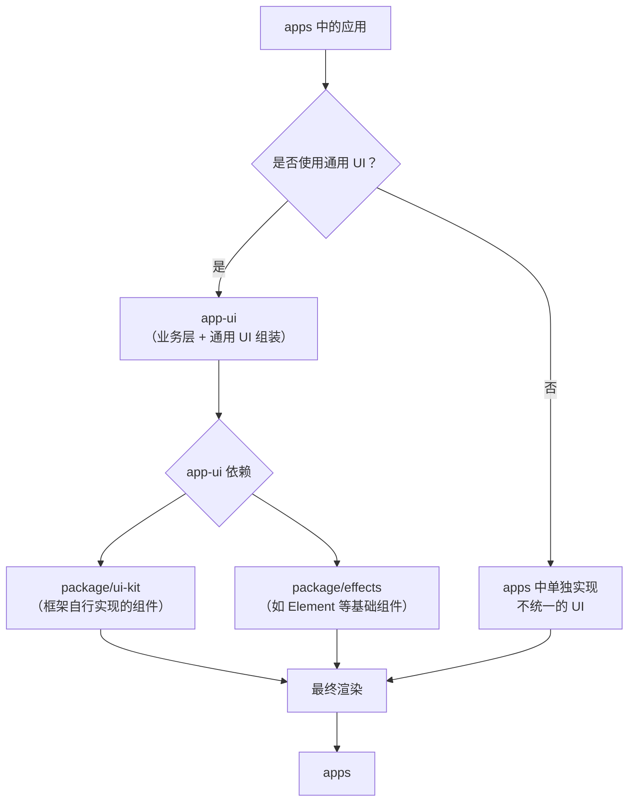
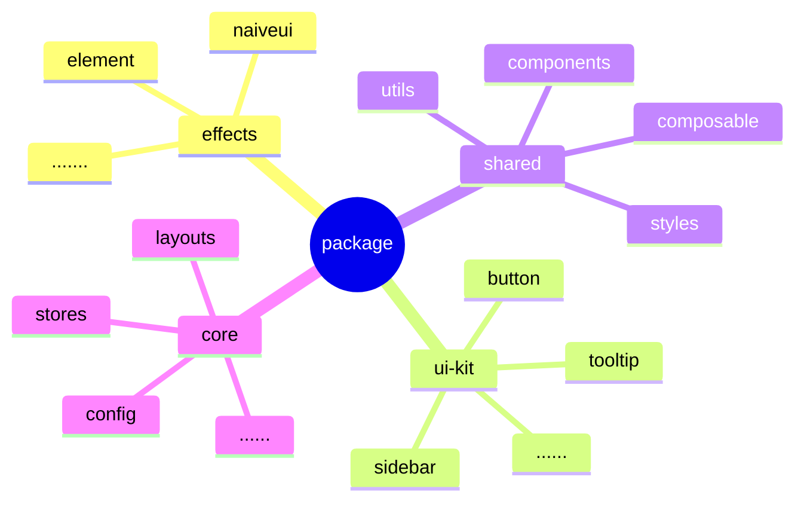

## 框架介绍

框架定位是为了方便自己快捷开发而诞生的。同时也是为了让自己熟悉pnpm、turboRepo等，主要是为了学习吧。

框架的下层组件基本都是基于使用shadcn/ui的，若后续需要改为react去开发，是允许在`package/ui-kit/react-ui`创建的（只要你配置好了tsconfig.json、vite.config.ts、components.json）。注意要使用shadcn库，而不是shadcn-vue了。

因为react、vue之间的生态是不一致的，所以后续应该会优化`internal/vite-config`提供的`defineViteConfig`方法，让其自动检测`apps`中的框架，然后使用对应的生态，但这是后话了。肯定还是需要使用`package.json`管理好依赖的


`package/effects`是专门负责第三方组件库的接入适配的，后续会提供一个适配器，让框架去接管第三方组件的configProvider的配置，统一第三方组件库的圆角、按钮大小等。

除了可以使用`package/effects`接入的第三方组件库外，框架内部`package/ui-kit`是基于`shadcn/ui`的自行实现的组件


### 技术栈

- pinia
- vue-router
- typescript
- turboRepo
- pnpm
- vite
- tailwindcss v4
- vue


## 目录结构
```sh
后续补充
```

如果你是为了实现业务去开发，只需要关注apps，在apps中编写代码就可以，你可以使用vite去创建基础骨架去开发，然后按照迁入指南接入到本框架中。当然你copy演示应用也可以。


## 框架目录介绍




### package目录

其目录大致分布如下图。



### internal目录

这个目录主要是为了统一一些配置，如typescript、vite、eslint等可以统一的配置。

目前有：`eslint-config`、`typescript-config`、`vite-config`

## 引入shadcn-vue

```bash
cd airovo-frame
pnpm dlx shadcn-vue@latest add [COMPONENT] -c packages/ui-kit/vue-ui
```

